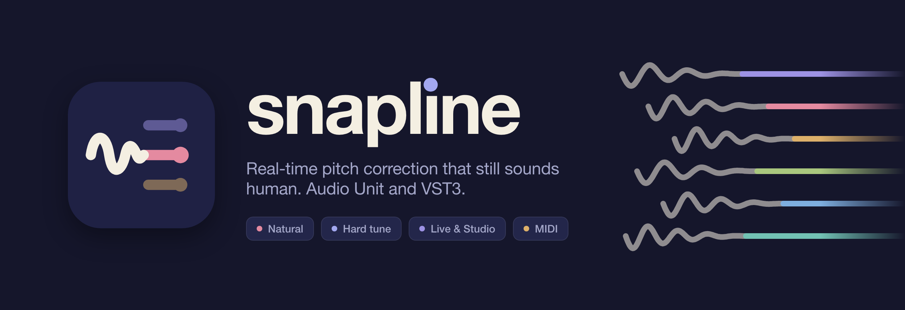
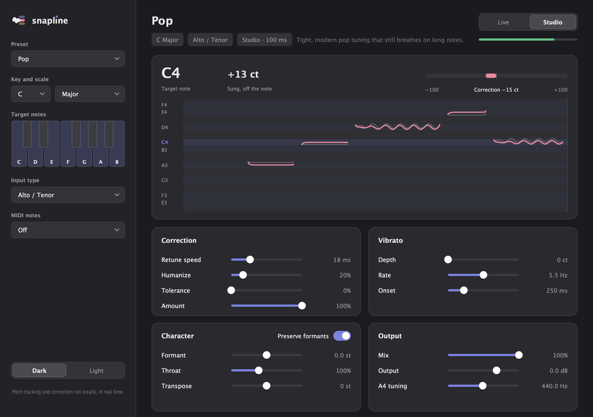
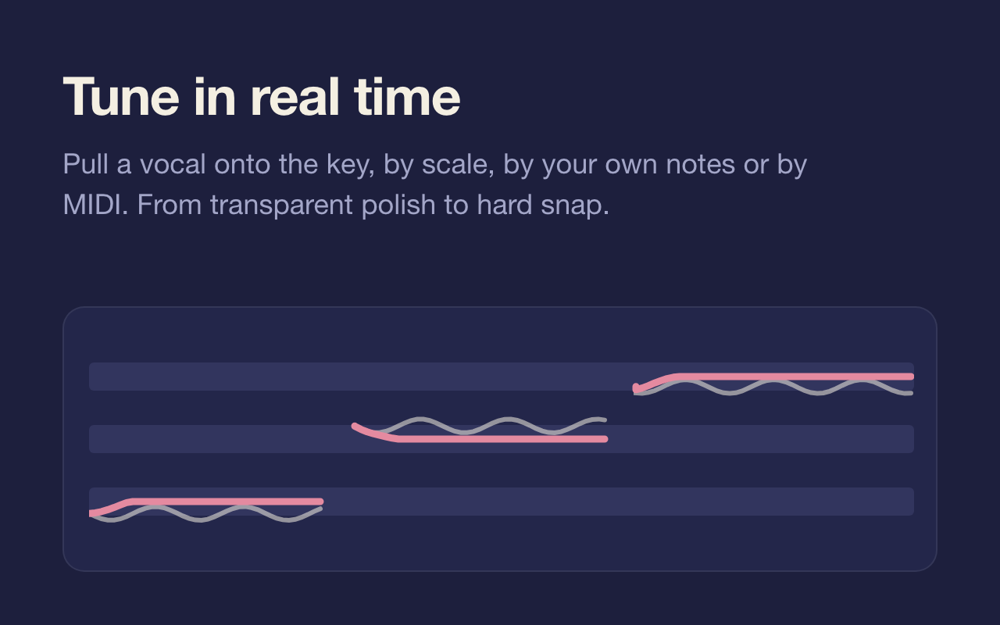
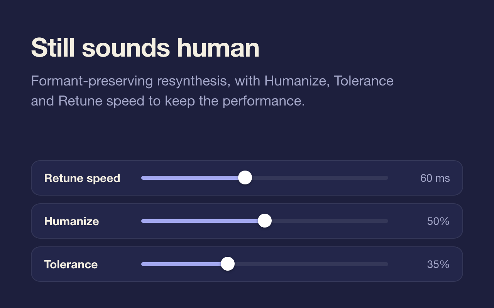
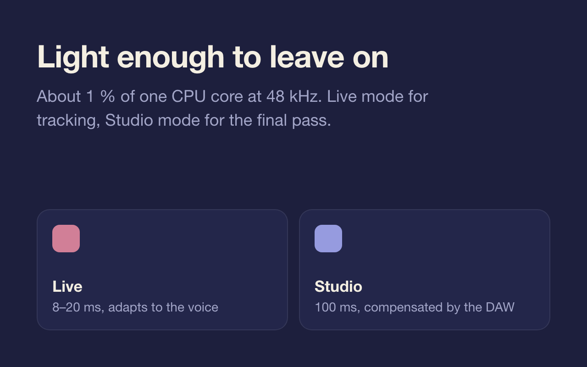
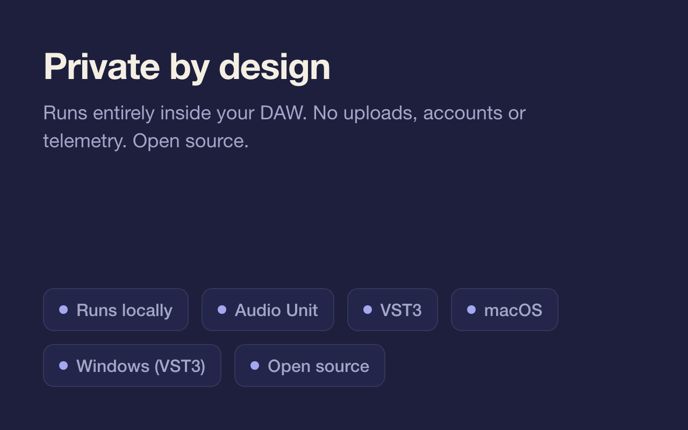

<div align="center">

<picture>
  <source media="(prefers-color-scheme: light)" srcset="docs/art/banner-light.png" />
  
</picture>

<br/><br/>

[](https://github.com/JonneNieminen/Snapline/actions/workflows/build.yml)
[](https://github.com/JonneNieminen/Snapline/releases/latest)
[](LICENSE)


<br/>


[](https://juce.com)
[](https://isocpp.org)

A sung line goes in wobbling and comes out on the note: natural, polished or hard-snapped,<br/>
in real time, with formants that stay human. Tune by key and scale, your own notes or MIDI. Nothing leaves your computer.

<br/>

<picture>
  <source media="(prefers-color-scheme: light)" srcset="docs/screenshots/snapline-light.png" />
  
</picture>

</div>

<br/>

<table>
  <tr>
    <td width="50%"><picture><source media="(prefers-color-scheme: light)" srcset="docs/art/card-tune-light.png" /></picture></td>
    <td width="50%"><picture><source media="(prefers-color-scheme: light)" srcset="docs/art/card-human-light.png" /></picture></td>
  </tr>
  <tr>
    <td width="50%"><picture><source media="(prefers-color-scheme: light)" srcset="docs/art/card-realtime-light.png" /></picture></td>
    <td width="50%"><picture><source media="(prefers-color-scheme: light)" srcset="docs/art/card-private-light.png" /></picture></td>
  </tr>
</table>

## Features

- **Natural or hard-tuned**: *Retune speed* runs from instant snapping (0 ms) to slow, transparent correction. *Humanize* lets sustained notes relax, *Tolerance* only touches notes the singer is already near, and *Amount* blends in as much of the correction as you want.
- **Formants stay put**: pitch-synchronous resynthesis (PSOLA) moves the pitch without the chipmunk effect. Shift the *Formant* or *Throat* length separately for character, or turn *Preserve formants* off for a synthetic sound.
- **Keys, scales and custom notes**: 12 scales in every key. Click the keys in *Target notes* to add or drop notes.
- **MIDI control**: snap to the notes you hold on a MIDI keyboard, or force the vocal to exactly the note you hold.
- **Studio and Live modes**: *Studio* looks ahead for the cleanest result and reports a fixed 100 ms delay that your DAW compensates for. *Live* keeps the delay low (typically 8–20 ms) for monitoring while you record.
- **Vibrato**: add vibrato with depth, rate and onset delay.
- **Live pitch display**: see the sung pitch, the corrected pitch, the current note and how much correction is applied.
- **Presets**: Natural, Gentle Polish, Pop, Hard Tune, Robot, Ballad and Deep Voice. Presets change only the correction style, never your key or scale.
- **Dark and light themes**, saved with the session.

## Install

Download the file for your computer from [Releases](https://github.com/JonneNieminen/Snapline/releases/latest):

| Platform | File | Formats |
|---|---|---|
| **macOS** (Apple silicon / Intel) | `Snapline-x.y.z-plugins-macos-arm64.zip` / `-macos-x86_64.zip` | Audio Unit, VST3 |
| **Windows** (x64) | `Snapline-x.y.z-windows-x64-setup.exe` (or the `-vst3.zip`) | VST3 |

- **macOS**: copy `Snapline.component` to `~/Library/Audio/Plug-Ins/Components` and `Snapline.vst3` to `~/Library/Audio/Plug-Ins/VST3`. The plugins aren't notarized yet, so remove the quarantine flag once:
  ```bash
  xattr -dr com.apple.quarantine ~/Library/Audio/Plug-Ins/Components/Snapline.component ~/Library/Audio/Plug-Ins/VST3/Snapline.vst3
  ```
- **Windows**: run the installer; it puts `Snapline.vst3` in `C:\Program Files\Common Files\VST3`. SmartScreen may warn, so choose *More info → Run anyway*.

Then rescan plugins in your DAW. In Logic Pro, Snapline is under **Audio Units → Snapline Audio**.

## Using Snapline

1. Put Snapline on the vocal track's **first insert**, before compression and effects.
2. Set **Key and scale**. If you don't know the key, *Chromatic* corrects to the nearest semitone.
3. Choose the **Input type** that matches the voice. It limits the pitch search range and avoids octave errors.
4. Start from a **Preset**, then adjust *Retune speed*: 0–10 ms for the hard-tune effect, 15–40 ms for modern pop, 50–100 ms for natural correction.
5. Use **Studio** mode for recorded tracks. Use **Live** while tracking, if you want to hear the tuned vocal in your headphones.

| Control | What it does |
|---|---|
| **Retune speed** | How quickly notes are pulled to pitch. 0 ms snaps instantly. |
| **Humanize** | Slows correction on sustained notes so they keep their natural movement. |
| **Tolerance** | Only corrects notes the singer is close to; higher values leave more untouched. |
| **Amount** | How much of the correction is applied. |
| **Vibrato depth · rate · onset** | Synthetic vibrato on held notes, fading in after the onset time. |
| **Formant** | Moves the voice's character up or down without changing pitch (±6 st). |
| **Throat** | Models a longer, darker (above 100 %) or shorter, brighter throat. |
| **Preserve formants** | On: natural voice at any pitch. Off: formants follow the pitch. |
| **Transpose** | Shifts the corrected pitch by up to an octave. |
| **Mix · Output** | Dry/wet blend (time-aligned in Studio) and output level. |
| **A4 tuning** | Reference pitch, 415–466 Hz. |
| **MIDI notes** | *Snap to held notes* uses held MIDI notes as the scale; *Force to held note* sets the exact target. |

### MIDI control

Send MIDI to Snapline from a MIDI track. In Logic Pro, create an **External MIDI** track and choose Snapline (on your vocal track) as its **MIDI Destination** in the track inspector. In other DAWs, route a MIDI track's output to the plugin. With *Snap to held notes*, the notes you hold replace the scale. When you hold nothing, the key and scale apply again.

### What to expect

Snapline corrects **monophonic** sources: one voice or a solo instrument. Harmonies, doubled vocals or bleed confuse the pitch tracker. Stereo inputs are tuned as a mono sum and sent to both outputs. With *Mix* below 100 %, the original stereo signal is blended back in.

Live mode's delay adapts to the voice. It needs about two to three pitch periods, so low voices get a little more delay, and the DAW can't compensate for it. Use Studio for the final pass on recorded vocals. See [`docs/HOW_IT_WORKS.md`](docs/HOW_IT_WORKS.md) for the details.

## Build from source

Requirements: macOS, CMake 3.22+, C++17, Xcode command line tools and JUCE 9.0.5 or newer.

```bash
git clone https://github.com/JonneNieminen/Snapline.git && cd Snapline
git clone --depth 1 --branch 9.0.5 https://github.com/juce-framework/JUCE.git third_party/JUCE
cmake -S . -B build -G "Unix Makefiles" -DCMAKE_BUILD_TYPE=Release -DCMAKE_OSX_ARCHITECTURES=arm64
cmake --build build --config Release --target Snapline_AU Snapline_VST3 -j 4
```

Products appear under `build/Snapline_artefacts/Release/`. Use `x86_64` for Intel or `arm64;x86_64` for a universal binary, and add `-DJUCE_DIR=/path/to/JUCE` if JUCE lives elsewhere.

Developer tools build with `-DSNAPLINE_BUILD_TOOLS=ON`:

- `SnaplineRender [wav-dir]` renders a synthetic off-key vocal at 44.1, 48 and 96 kHz. It checks pitch accuracy, transparency, latency, formants, transpose, MIDI forcing, block sizes, silence and CPU cost, and optionally writes WAV files.
- `SnaplineSnapshot [dir]` renders the interface in both themes to PNG (the screenshots above).

On Windows (Visual Studio 2022 or newer and CMake), configure with `cmake -S . -B build -A x64` and build `Snapline_VST3` in `Release`; `build/windows/snapline.iss` packages it with [Inno Setup](https://jrsoftware.org/isinfo.php).

CI ([`build.yml`](.github/workflows/build.yml)) builds AU and VST3 for Apple Silicon and Intel and the VST3 for Windows x64, runs the DSP checks on every platform and validates the Audio Unit with `auval`. [`release.yml`](.github/workflows/release.yml) publishes the macOS plugin zips and the Windows installer.

The logo masters come from `design/logo/make.py`, the README art from `design/banners/render.sh` (headless Chrome) and the theme from `design/theme/tokens.css` (mirrored in `Source/DesignTokens.h`).

## Architecture

```
Host ──▶ SnaplineAudioProcessor ──▶ SnaplineDsp ──▶ output
   mono analysis → YIN pitch track (375 frames/s) → note decision, retune, humanize,
   tolerance, vibrato → pitch marks → PSOLA grains (formant / throat resampling)
   → overlap-add → dry/wet mix

SnaplineAudioProcessorEditor ──▶ parameters (AudioProcessorValueTreeState)
        └─ PitchGraph ◀── lock-free FIFO of analysis frames from the audio thread
```

| Path | What's there |
|---|---|
| [`Source/SnaplineDsp.*`](Source/SnaplineDsp.cpp) | The engine: tracking, correction and PSOLA resynthesis. Real-time safe, no plugin types. |
| [`Source/PitchDetector.*`](Source/PitchDetector.cpp) | FFT-based YIN pitch estimator. |
| [`Source/Scales.h`](Source/Scales.h) · [`Source/Presets.h`](Source/Presets.h) | Scales and factory presets. |
| [`Source/PluginProcessor.*`](Source/PluginProcessor.cpp) | Parameters, MIDI notes, presets as programs, latency reporting and state. |
| [`Source/PluginEditor.*`](Source/PluginEditor.cpp) · [`Source/PitchGraph.*`](Source/PitchGraph.cpp) | Interface and pitch display. |
| [`Source/DesignTokens.h`](Source/DesignTokens.h) | Dark and light palettes. |
| [`tools/render`](tools/render/Main.cpp) · [`tools/snapshot`](tools/snapshot/Main.cpp) | Offline DSP checks and interface screenshots. |

Parameter IDs are stable so saved DAW sessions keep working.

## Privacy

No network access, accounts or telemetry. Audio is processed in memory and never stored.

## Contributing

Issues and pull requests are welcome; see [CONTRIBUTING.md](CONTRIBUTING.md).

## License

Snapline is [MIT](LICENSE) licensed. It is built with [JUCE](https://juce.com), which is available under the AGPLv3 or a commercial license; check JUCE's terms before distributing your own builds. Auto-Tune and Waves Tune are trademarks of their owners; Snapline is not affiliated with them.
